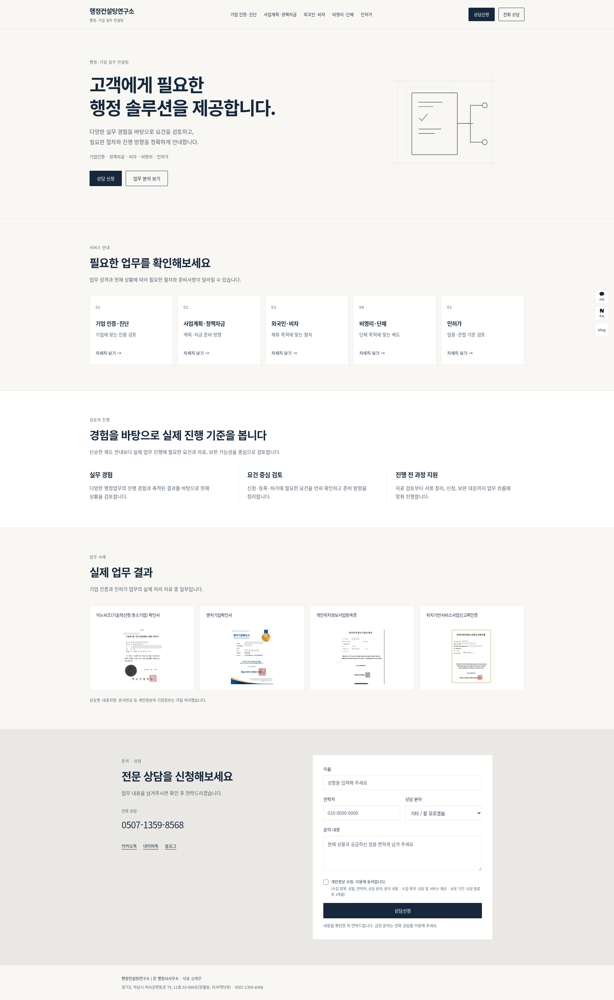
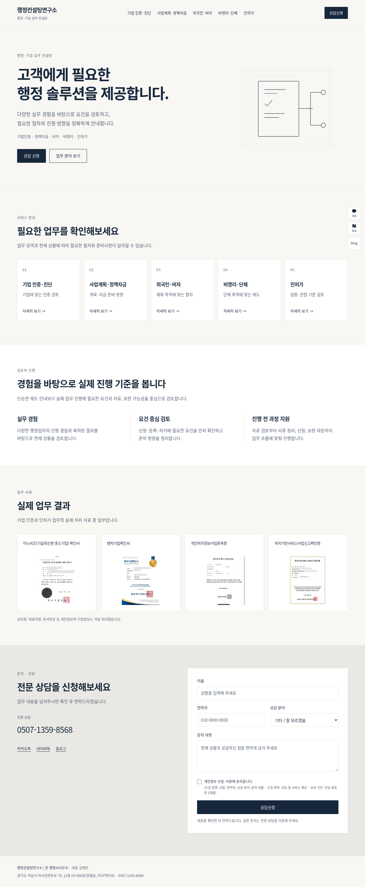
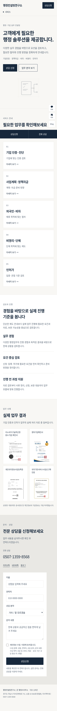

# 메인 리디자인 검토본

이 브랜치는 검토용입니다. `main`과 운영 사이트에 반영하지 않았습니다.

## 화면 캡처

- [PC 1920px 전체 화면](home-1920.png)
- [PC 1280px 전체 화면](home-1280.png)
- [모바일 375px 전체 화면](home-375.png)

## 미리보기

- [캡처 모아보기 HTML](preview.html): 파일을 다운로드한 뒤 브라우저로 열면 인터넷 연결 없이 캡처를 볼 수 있습니다.
- 실제 리디자인은 브랜치 루트의 `index.html`에 있습니다. 이 브랜치를 다운로드하고 저장소 루트에서 `python -m http.server 8080`을 실행한 뒤 `http://localhost:8080/`를 열면 SVG 애니메이션을 포함한 화면을 확인할 수 있습니다.
- 캡처는 정지 화면입니다. 문서·체크·연결선·노드 애니메이션은 최초 진입 시 한 번만 실행되며 reduced-motion에서는 제거됩니다.
- 검토 중 실제 상담 전송은 하지 마세요. 루트의 상담폼은 기존 운영 기능을 유지합니다.

## PC 1920px

## PC 1280px

## 모바일 375px

