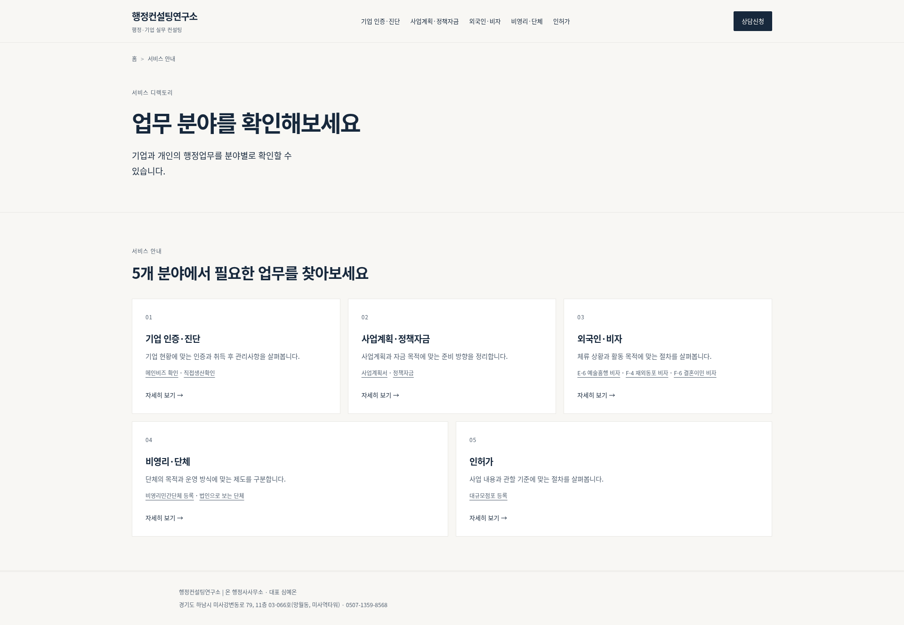
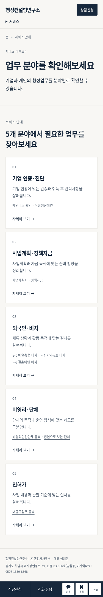
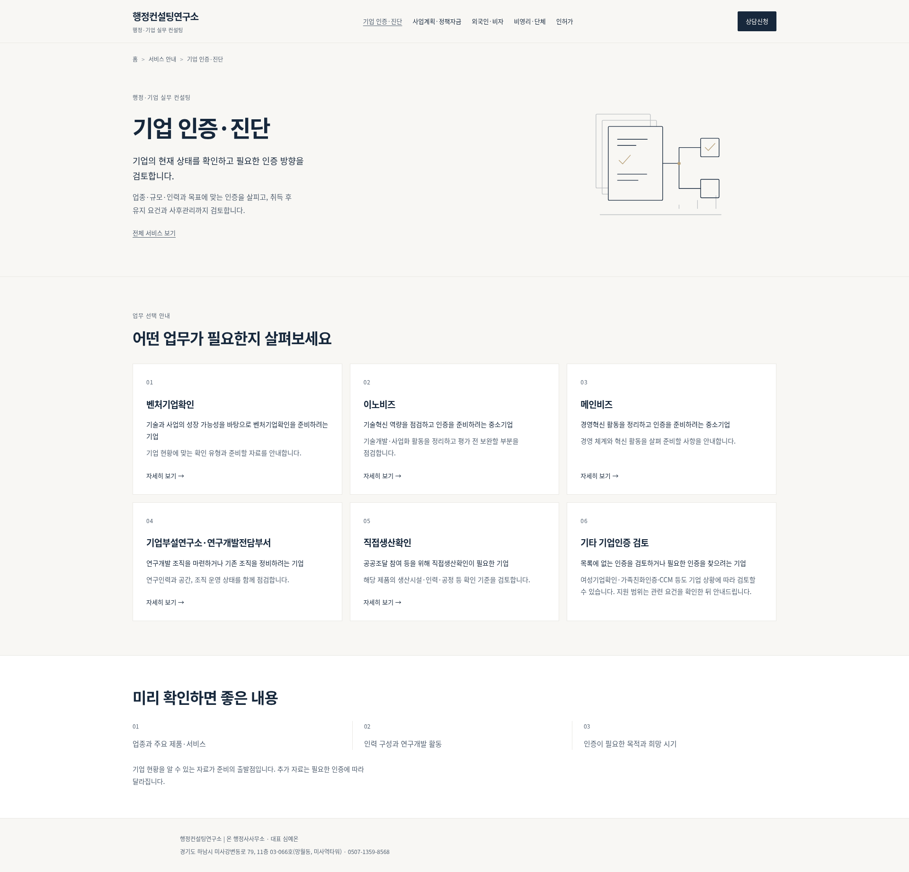
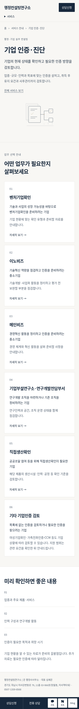
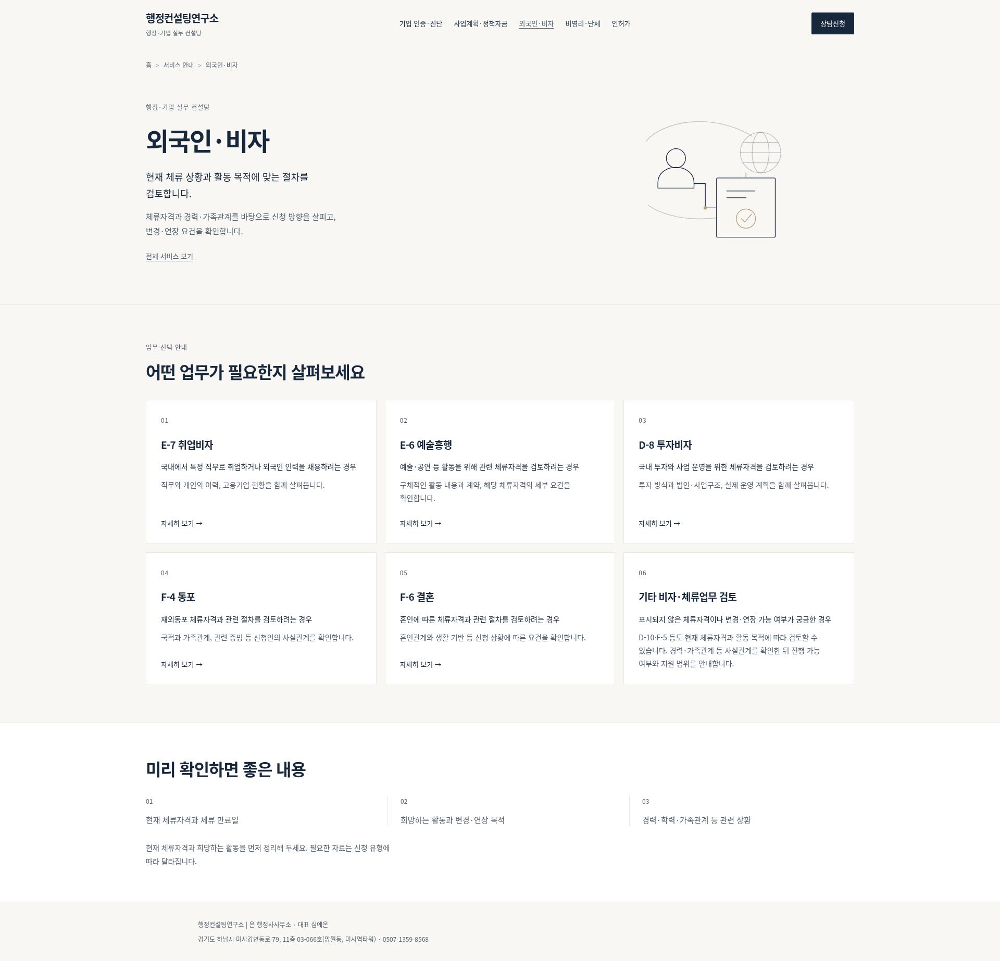
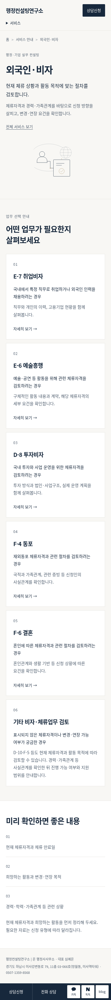
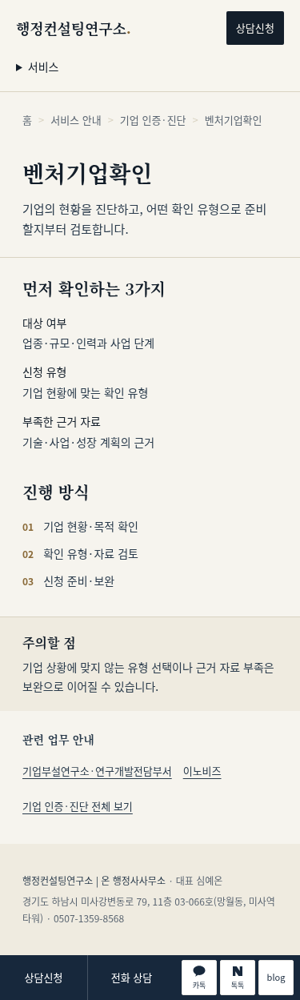
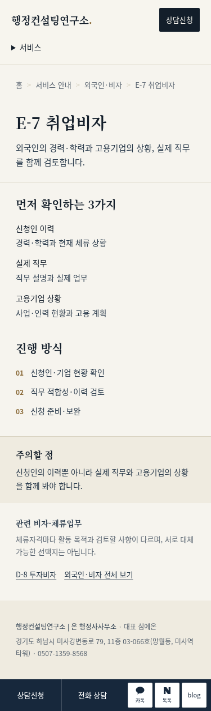
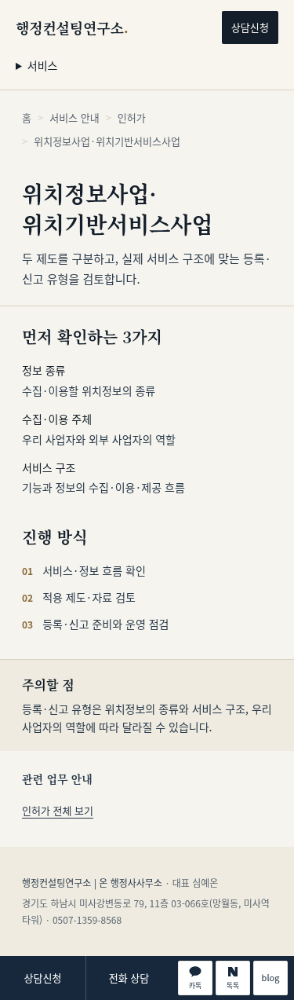

# 서비스 리디자인 검토 캡처

현재 미커밋 작업 화면을 담은 검토용 캡처입니다. 이 브랜치에는 캡처와 README만 추가했으며, 실제 리디자인 코드와 운영 사이트는 변경하지 않았습니다.

PC는 1920×1080, 모바일은 375×900에서 확인 후 전체 페이지를 캡처했습니다. 전체 캡처에서는 고정 상담 UI를 페이지 맨 아래에 표시했습니다. 모바일 상담 UI는 메인과 동일합니다.

## 캡처 목록

| 페이지 | 화면폭 | 직접 보기 |
|---|---|---|
| 서비스 전체 허브 | 1920px | [캡처 열기](services-1920.png) |
| 서비스 전체 허브 | 375px | [캡처 열기](services-375.png) |
| 기업 인증·진단 | 1920px | [캡처 열기](business-certification-1920.png) |
| 기업 인증·진단 | 375px | [캡처 열기](business-certification-375.png) |
| 외국인·비자 | 1920px | [캡처 열기](visa-1920.png) |
| 외국인·비자 | 375px | [캡처 열기](visa-375.png) |
| 벤처기업확인 상세 | 375px | [캡처 열기](venture-375.png) |
| E-7 취업비자 상세 | 375px | [캡처 열기](e-7-375.png) |
| 위치정보사업 상세 | 375px | [캡처 열기](location-information-375.png) |

## 서비스 전체 허브 · 1920px

## 서비스 전체 허브 · 375px

## 기업 인증·진단 · 1920px

## 기업 인증·진단 · 375px

## 외국인·비자 · 1920px

## 외국인·비자 · 375px

## 벤처기업확인 상세 · 375px

## E-7 취업비자 상세 · 375px

## 위치정보사업 상세 · 375px

